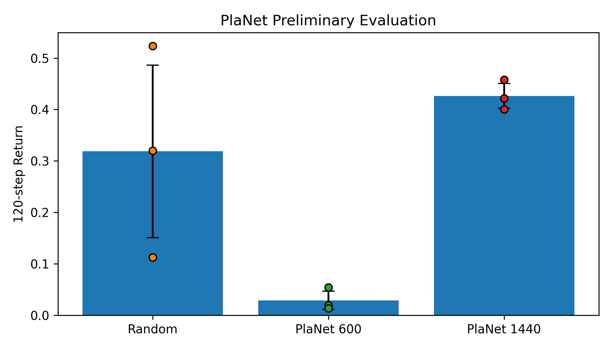
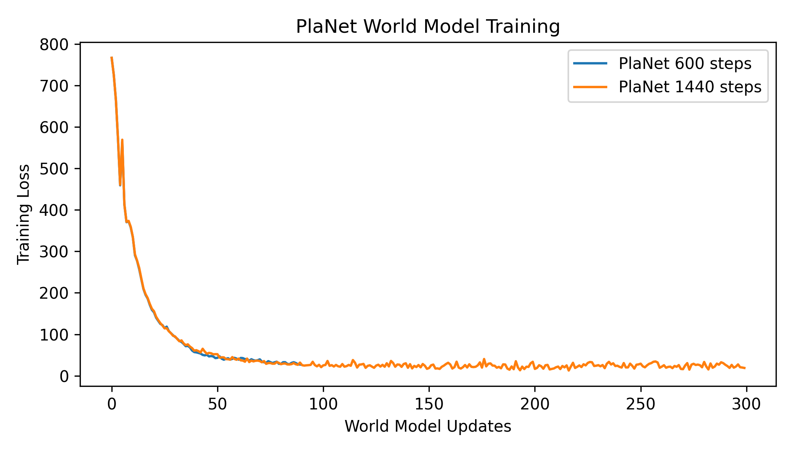

# PlaNet Baseline — 11-785 Midterm

This directory contains the **preliminary PlaNet world-model and Cross-Entropy Method (CEM) planning experiments** for our Carnegie Mellon University 11-785 project, *Learning to Act in Imagination: Model-Based Reinforcement Learning from Pixels*.

> **Scope:** These are short, CPU-based engineering/pilot experiments on **DeepMind Control Suite Cartpole-Swingup**, not a full reproduction of the PlaNet paper. DreamerV1, 500k-step experiments, and visual-shift robustness tests are **not** implemented in this folder.

## Midterm results

All reported returns are **120-environment-step cumulative rewards**, measured on evaluation environment seeds **42, 43, 44** (mean ± population standard deviation across *evaluation* seeds).

| Policy | Training environment steps | Mean return ± std |
| --- | ---: | ---: |
| Random actions | — | 0.3186 ± 0.1677 |
| PlaNet pilot, Run 1 | 600 | 0.0290 ± 0.0181 |
| PlaNet pilot, Run 2 | 1,440 | **0.4265 ± 0.0238** |

The larger pilot run has a mean return about **33.9% above** the random-action mean under this short evaluation protocol. The two PlaNet checkpoints came from **separate training runs** with not all sources of randomness controlled; this is **not** a statistically established effect of more training steps. The three evaluation seeds are **not** three independent model-training seeds.



The following plot shows **world-model optimization loss**, **not** an episode-return learning curve:



## Implementation

- Environment: `dm_control` / MuJoCo, `cartpole` domain and `swingup` task
- Input: 64 × 64 RGB pixels; action: one continuous control value
- World model: convolutional encoder/decoder, RSSM with deterministic GRU state and stochastic latent state, reward predictor
- Approximately 2.64 million world-model parameters
- Online control: CEM planning using predicted latent rewards
- Data: environment-collected observation/action/reward sequences stored in a replay buffer

**Pilot settings (both runs):** CPU; batch size 4; chunk length 16; planning horizon 5; 32 CEM candidate plans; 2 optimization iterations; 8 elites; 30 world-model updates per round; 2 initial random 120-step trajectories. Run 1 has 3 rounds (90 updates); Run 2 has 10 rounds (300 updates). Each subsequent training rollout is capped at 120 steps.

The pilot scripts modify the upstream loss at runtime (`Planet.compute_loss = aligned_loss`), including an experimental reward-target offset and mean-based prediction losses. These modifications **have not been established as a faithful implementation of the published PlaNet objective** and should be reviewed before larger experiments.

## Files

| File | Purpose |
| --- | --- |
| `model_based_agent.py`, `planet.py`, `networks.py`, `utils.py` | Adapted PlaNet, CEM, RSSM, replay buffer, and environment utilities |
| `configs.yaml` | Base parameter definitions; the pilot scripts override settings for Cartpole-Swingup |
| `midterm_pilot.py` | Train Run 1 (600 environment steps) |
| `midterm_pilot_v2.py` | Train Run 2 (1,440 environment steps) |
| `midterm_eval.py` | Evaluate Run 1 checkpoint against random actions |
| `midterm_eval_v2.py` | Evaluate Run 2 checkpoint against random actions |
| `midterm_pilot_checkpoint.pt`, `midterm_pilot_v2_checkpoint.pt` | Uploaded pilot model checkpoints used by the evaluation scripts (Run 1 and Run 2, respectively) |
| `midterm_pilot_metrics.npz`, `midterm_pilot_v2_metrics.npz` | Training losses, training-rollout returns, and step counts |
| `midterm_eval_results.npz`, `midterm_eval_v2_results.npz` | Saved evaluation seeds and per-seed returns |
| `midterm_baseline_comparison.png`, `midterm_training_loss.png` | Figures included in the midterm report |

## Environment and dependencies

The experiments were run in **Google Colab on CPU**, with **headless MuJoCo/OSMesa** rendering. A clean reinstall of this environment has **not** been independently validated.

Important Python imports in the uploaded code include:

- `torch`, `numpy`, `scipy`, `matplotlib`
- `dm_control` (MuJoCo), `gymnasium`, `cv2` (OpenCV)
- `PyOpenGL`, `einops`, `tensorboardX`, `ruamel.yaml`, `moviepy.editor`

The source imports `gymnasium.wrappers.PixelObservationWrapper` and `moviepy.editor`; newer major versions may remove or change these interfaces. **Gymnasium 0.29.1 and MoviePy 1.x** are more consistent with those imports than newer major releases. The Colab Python 3.13 environment previously caused native/OpenGL dependency issues, so a compatible isolated Python environment (for example, Python 3.10/3.11) is preferable when reproducing.

For headless **Linux** runs, first install the appropriate OSMesa system libraries through your system's package manager. Set the rendering backend **before launching Python**:

```bash
export MUJOCO_GL=osmesa
export PYOPENGL_PLATFORM=osmesa
export MPLBACKEND=Agg
```

Do not assume these Linux OSMesa instructions apply unchanged to a local macOS installation or to an HPC node.

## Running the experiments

From the repository root:

```bash
cd planet_baseline
```

### Evaluate the uploaded checkpoints (no retraining required)

The repository now includes **both** pilot checkpoints in this directory:

- `midterm_pilot_checkpoint.pt` — Run 1, 600 environment steps
- `midterm_pilot_v2_checkpoint.pt` — Run 2, 1,440 environment steps

After preparing a compatible Python/MuJoCo environment, you can run the evaluation scripts directly **from `planet_baseline/`**:

```bash
python -u midterm_eval.py       # loads midterm_pilot_checkpoint.pt
python -u midterm_eval_v2.py    # loads midterm_pilot_v2_checkpoint.pt
```

Both scripts use `torch.load` and expect the checkpoint to contain `model` and `params`; the scripts report 120-step returns for evaluation environment seeds 42, 43, and 44. The files' presence in GitHub has been confirmed, **but a fresh end-to-end load/evaluation after upload has not yet been independently verified**.

### Optional: rerun training from scratch

To regenerate the checkpoints rather than use the uploaded ones, execute the pilot scripts separately:

```bash
python -u midterm_pilot.py       # Run 1: 600 steps / 90 model updates
python -u midterm_pilot_v2.py    # Run 2: 1,440 steps / 300 model updates
```

**Warning:** training saves checkpoint files under the same names, so rerunning these commands locally can overwrite the checkpoints in your working directory. Make copies if you need to preserve the originally uploaded models. Training also creates `.npz` metrics and diagnostic `.png` plots; evaluation creates per-seed result `.npz` files.

For a lightweight inspection of **already committed evaluation data** without retraining:

```python
import numpy as np
for filename in ["midterm_eval_results.npz", "midterm_eval_v2_results.npz"]:
    with np.load(filename) as d:
        print(filename)
        print("seeds:", d["seeds"].tolist())
        print("random returns:", d["random_returns"].tolist())
        print("PlaNet returns:", d["planet_returns"].tolist())
        print("PlaNet mean:", d["planet_returns"].mean())
```

## Limitations and next steps

- Only **120-step rollouts** and three evaluation-environment seeds are included; do not compare these returns directly with published 1,000-step benchmarks.
- Reported optimization losses do **not** establish robust control or prediction accuracy.
- Reward/action/state temporal alignment, model-loss choices, and planning behavior require further auditing.
- Planned work: consistent complete-episode evaluation, longer training and checkpoint learning curves, independent training seeds, DreamerV1 actor–critic comparison, and controlled visual shifts/augmentation.

## Attribution

The base PlaNet implementation in this directory is **adapted from** [smmislam/pytorch-planet](https://github.com/smmislam/pytorch-planet), itself referring to the original PlaNet paper and related implementations. The short-pilot scripts and midterm results are additions made for this project. Review the upstream repository's license and preserve applicable notices when reusing or redistributing its code.

**Paper:** Hafner et al., [*Learning Latent Dynamics for Planning from Pixels*](https://arxiv.org/abs/1811.04551) (ICML 2019).

**Project:** Carnegie Mellon University, 11-785 Introduction to Deep Learning (Fall 2026).
