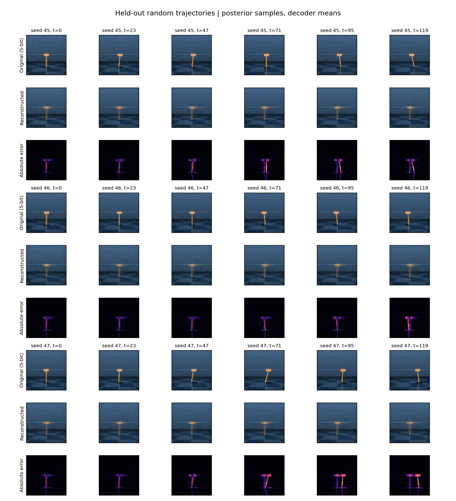
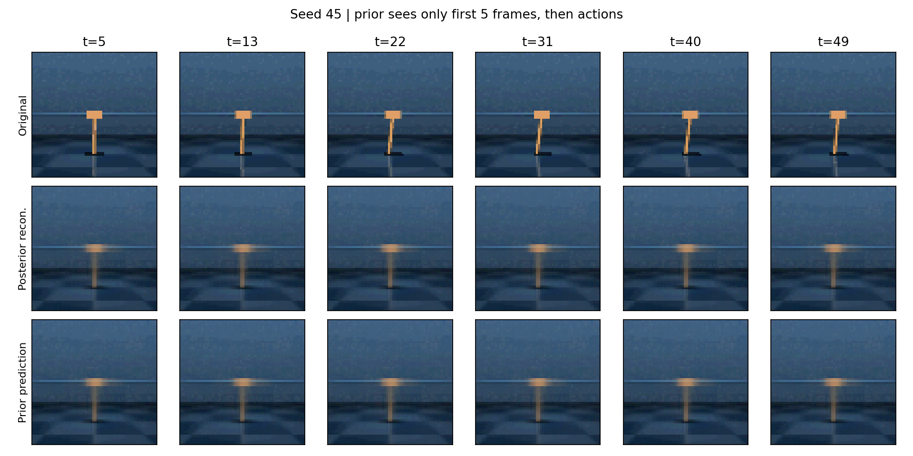
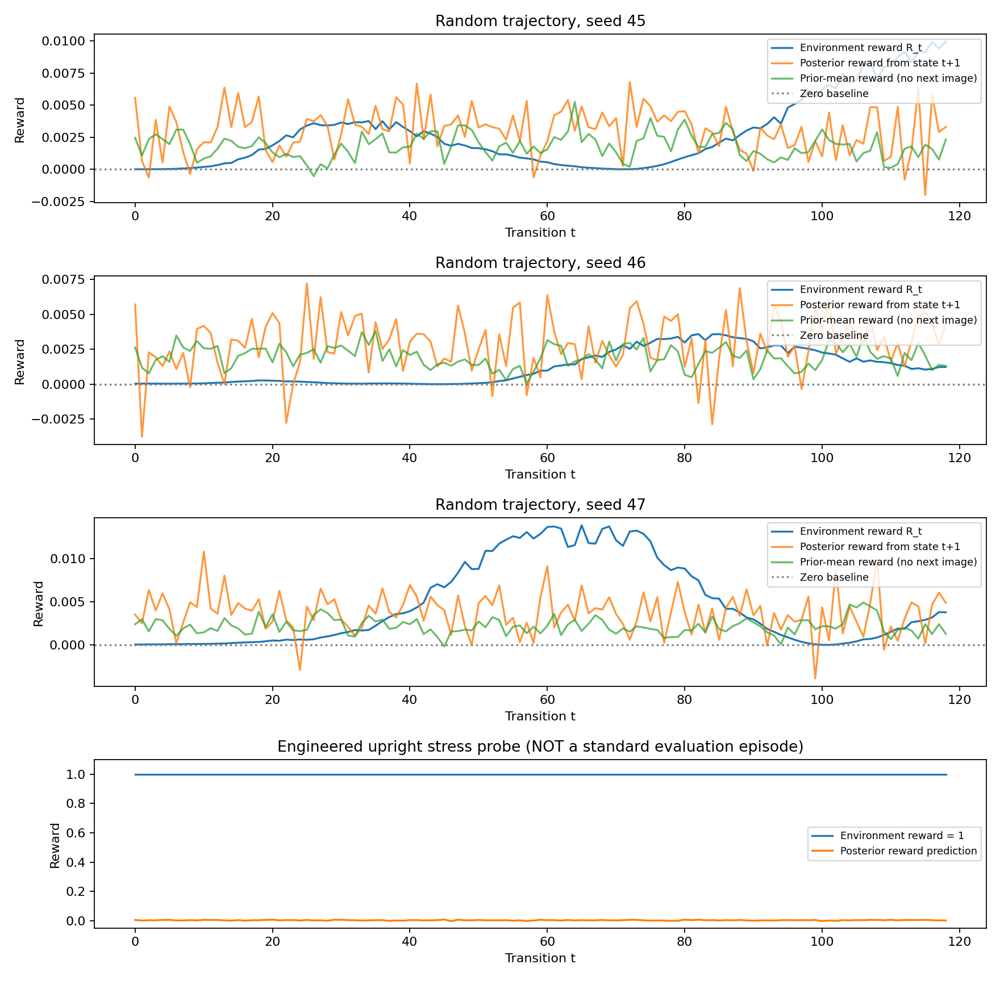

# Lyra — RSSM World Model 检查与实验结果

本次完成了 RSSM 结构检查、已有 checkpoint 的图像重建测试，以及 reconstruction loss 和 reward prediction 检查。**网络形状、概率分布和反向传播检查均通过，但这个短训模型主要学到了静态背景，尚未可靠恢复运动物体或预测奖励。** 测试没有重新训练或修改原始模型、pilot 脚本及 checkpoint。

参考：[本地 DreamerV1 论文](../../1912.01603v3.pdf)，第 6 页 Section 4 / Eq. (9)–(10)，第 14 页 Appendix A；第 5 页 Figure 5 用于区分 posterior reconstruction 与 prior open-loop prediction。这是针对当前 pilot 的审计，不是论文规模的复现实验。

## 1. RSSM 实现检查

| 部件 | 当前实现与张量尺寸 | 检查结论 |
| --- | --- | --- |
| Encoder | `3×64×64 → 32×31×31 → 64×14×14 → 128×6×6 → 256×2×2 → 1024` | 4 层 stride-2 CNN + ReLU；输出与 `feat_dim=1024` 一致 |
| GRU | `h_(t+1) = GRU([z_t, a_t], h_t)`；Cartpole 输入 `30+1`，隐藏状态 200 | 递推时序、输入/输出维度正确 |
| Prior | `p(z_t | h_t)`，由 200 维隐藏状态输出 30 维均值与标准差 | `Independent(Normal(...), 1)`；不接收当前图像 |
| Posterior | `q(z_t | h_t, enc(o_t))`，输入 `200+1024` | 对角高斯；训练用 `rsample()`，允许重参数化梯度 |
| Standard deviation | `softplus(pre_std + 0.55) + 0.01` | 正值与最小标准差检查通过 |
| Decoder | `[h_t,z_t] (230) → 1024 → 1024×1×1 → 128×5×5 → 64×13×13 → 32×30×30 → 3×64×64` | 转置卷积尺寸正确，图像分布固定标准差为 1 |
| Reward head | `[h_t,z_t] → 200 → 200 → 1` | 输出标量高斯，固定标准差为 1；输出均值不限制在 `[0,1]` |
| KL | `KL(posterior || prior)`；对每个时间/样本的完整 latent KL 设置 3 free nats | KL 方向、latent 维度求和与 free-nats 下界一致 |

Checkpoint 严格加载成功，参数数目为 **2,644,220**。六个模块均有有限且非零的参数梯度。

该结构符合连续高斯 RSSM 的基本分解，但不能据此称为逐项复现 DreamerV1：例如，当前 reward head 是两层 200 单元 ReLU，论文 Appendix A 描述的其他 dense 函数使用三层 300 单元 ELU；当前训练量与超参数也不同。论文指出 Dreamer 的实验不需要 latent overshooting，缺少它本身不是 DreamerV1 的实现错误。

## 2. 测试设置

- 模型：`midterm_pilot_v2_checkpoint.pt`，记录训练环境步数 **1,440**，训练环境种子为 42。
- SHA-256：`575ebf2268fbc480b1c41422576a7157ef2855e3a6d61269fa960be39199f3fb`。
- 环境：DMC `cartpole/swingup`，相机 0，64×64 RGB，每次动作执行一个底层环境步（原配置 `action_repeat=0`）。
- 三条新环境种子的随机动作轨迹：**45、46、47，各 120 步**；共 360 张图像、357 个对齐奖励样本。它们不是三个独立训练种子。
- 主结果：posterior latent 采样；使用 decoder/reward distribution 的均值；不额外添加图像噪声。模型 RNG 按 `10000 + 环境种子` 固定。
- 预处理：完全保留旧代码的 5-bit 量化、float16 预处理舍入和 `H,W,C → C,W,H` 轴顺序。显示时正确逆转，不能直接改用 `C,H,W` 后评估旧权重。
- 额外报告 posterior mean latent 的确定性诊断；它不能代替论文中随机 latent 的主结果。
- 原始图像、动作和奖励保存在 `trajectories.npz`，支持离线重新生成结果。

## 3. Original vs. Reconstructed Images



每个种子固定选取 6 个等间隔时刻，依次展示原始模型输入（5-bit）、重建和绝对误差。没有按重建效果挑选图片。只在显示时裁剪至 `[0,1]`；指标使用未裁剪的网络输出。

| 环境种子 | 逐像素 MSE ↓ | PSNR / dB ↑ | 每帧像素 SSE ↓ | 首帧复制基线 MSE ↓ |
| --- | ---: | ---: | ---: | ---: |
| 45 | 0.001671 | 27.77 | 20.532 | 0.002727 |
| 46 | 0.001192 | 29.24 | 14.652 | 0.001100 |
| 47 | 0.002223 | 26.53 | 27.317 | 0.003304 |
| 合并 360 帧 | **0.001695** | **27.71** | **20.834** | — |

MSE 在归一化像素上计算；每帧 SSE = MSE × 12,288；PSNR 使用 `data_range=1`，合并 PSNR 从合并 MSE 计算。首帧复制基线在整条轨迹上反复输出第一帧，用于判断静态场景是否让误差显得过小。

**解释：** 背景纹理与整体配色可恢复，但小车和杆被重建为模糊、近乎固定的形状。种子 46 上，模型甚至略逊于首帧复制基线。因此约 28 dB 的 PSNR 不能说明已学会准确的位置、角度或动力学。



额外按论文 Figure 5 的思路，先输入 5 帧，然后只用实际动作和 prior 预测接下来的 45 帧；三条轨迹的开环 MSE 分别为 **0.001128 / 0.000929 / 0.001092**。这段区间与整条 120 帧重建测试不同，不能直接比较两组 MSE。图中开环输出同样接近静态平均场景；背景占据大部分像素，低误差尚不能证明长期预测正确。

## 4. Reconstruction Loss 是否合理

论文 Eq. (10) 使用 observation/reward log likelihood 与 KL。对固定标准差为 1 的高斯，负 log likelihood 为 `0.5 × SSE + constant`。

当前存在两个损失版本，必须区分：

1. **`planet.py::compute_loss` 原始版本：** 从 decoder/reward 的高斯分布再次 `rsample()`，再对样本计算平方误差。固定单位方差会让图像 SSE 的期望额外增加 **12,288**、标量 reward MSE 额外增加 **1**。这不会在期望上改变均值回归的最优点，但会增加损失和梯度噪声，使记录的数值难以解释为预测误差。原始 reward target 也未偏移。
2. **`midterm_pilot_v2.py::aligned_loss` 实际训练版本：** 运行时覆盖原始函数，使用分布均值，reward target 做一帧偏移；当前 checkpoint 来自这个 pilot。检查原始 `compute_loss` 的问题，不能直接推断这个 checkpoint 训练时也用了原始损失。

在同一批短序列、相同预测分布上，重复调用原始损失 8 次，图像项为 **12,297.81 ± 44.80**；均值重建 SSE 为 **11.8794**。这与单位方差造成约 12,288 的额外项相符。这里的 ± 为 8 次诊断调用的总体标准差，不是训练种子误差条。原始 reward loss 均值为 1.2965；其样本很少，且 target 与 pilot 不同，不应把二者之差全归于采样噪声。

Pilot 的均值平方误差避免了这层观测噪声，但使用完整 SSE/MSE，而非 `0.5 × SSE/MSE`。因此，忽略常数后，当前 objective 仍与单位高斯 NLL + KL 的相对权重相差一个因子，正式复现时需统一定义。诊断代码中的 `mean_objective()` 明确保留 pilot 的尺度，避免混淆旧实验。

## 5. Reward Prediction 是否合理

旧 replay 每行保存 `(o_t, a_t, R_t)`，其中 `R_t` 是执行 `a_t` 后返回的奖励。当前状态在执行动作前由 `o_t` 推断，因此与 CEM 的下一状态奖励约定一致的比较是：

```text
state_t -- action_t --> state_(t+1)
reward_head(state_(t+1))  对应  R_t
predicted_rewards[1:]    对应  stored_rewards[:-1]
```

首个状态没有匹配的入站奖励，最后一个 buffer 奖励没有匹配的后继图像，均不计入对齐评估。不要通过选择误差最低的偏移来决定时序。Pilot 的一帧偏移与上述约定一致；原始未偏移版本不一致。



| 环境种子 | 对齐 posterior MSE ↓ | 全零预测 MSE ↓ | R² ↑ | 真实奖励最大值 |
| --- | ---: | ---: | ---: | ---: |
| 45 | 1.2251e-5 | 1.5222e-5 | -0.613 | 0.00995 |
| 46 | 8.1817e-6 | 2.9597e-6 | -4.448 | 0.00359 |
| 47 | 2.8777e-5 | 4.4793e-5 | -0.250 | 0.01385 |
| 合并 357 对 | **1.6403e-5** | **2.0992e-5** | **-0.291** | — |

对每条轨迹，R² 都小于 0：模型不如事后输出该轨迹真实奖励均值的常数基线。该常数用到了测试奖励，只作为解释性参考，不是可以部署的策略。合并 MAE 为 **0.003162**。

另外，在读入下一张图像前，用 prior mean latent 预测奖励，合并 MSE 为 **1.5081e-5**。这单独检查了不依赖后继图像的预测路径；它是 prior-mean 诊断，与 CEM 的随机 latent rollout 不完全相同。所有 reward 指标使用原始预测，未像规划器那样裁剪奖励。

**额外高奖励诊断：** 在另一个环境中显式设置 `qpos=qvel=0`，使杆精确直立，执行零动作 120 步。真实奖励保持 **1.0**，posterior reward 平均预测为 **0.003324**，对齐 MSE 为 **0.993367**。这不是默认 reset、正常策略回报或正式 benchmark，只是检查模型对未被上述低奖励轨迹覆盖区域的响应；它暴露出该 checkpoint 的高奖励泛化不足，不能据此单独判定网络结构错误。

**判断：** 低奖励轨迹上的绝对 MSE 很小，但并未稳定超过简单基线，也不能识别这个高奖励诊断状态。当前不足以把 reward head 视为可靠的规划或 actor 训练信号。

## 6. 集成前应处理的问题

- **统一损失和时间约定：** 让正式训练入口明确选择 incoming-reward target 和 likelihood 尺度，避免训练结果依赖脚本的运行时 monkey patch；旧 checkpoint 继续按旧语义解释。
- **保留历史图像轴顺序：** 旧模型使用 `C,W,H`。未来可统一为 `C,H,W`，但需显式标记预处理版本并重新训练；不能只改评估。
- **训练与评估分开：** 原始 `Planet.forward` 即使在 `eval()` 下仍无条件添加 Gaussian 像素噪声，并把 batch size / sequence length 写死为配置值。本诊断直接调用子模块进行无噪声过滤，保留原始代码供检查。正式接口应从输入推断长度，并明确噪声开关；通常的像素 dequantization 与这里的零均值 Gaussian 噪声也不同。
- **继续训练并改善数据覆盖：** 仅 1,440 个训练环境步不足以检验论文性能；增加包含成功摆起和高奖励区域的数据，并同时报告对象细节、多步预测和 reward 基线。不能只根据总损失下降判断成功。
- **修正旧视频评估循环：** `ModelBasedLearner.evaluate_video_prediction` 的未来预测循环嵌在 context 循环内，且图像列表时间索引不匹配，不能直接当作论文 Figure 5 式评估。本次独立实现 5 帧 context + 45 帧 prior-only 预测。

上述是检查发现和后续修改建议，本交付保持原训练文件及权重不变。

## 7. 交付文件与复现

| 文件 | 内容 |
| --- | --- |
| `../rssm_diagnostics.py` | checkpoint 加载、真实 DMC 数据采集、重建、奖励和开环诊断、绘图；也支持离线重放 |
| `../test_rssm_diagnostics.py` | 5 项自动检查：网络/梯度、像素轴顺序、奖励边界/异常、损失与高斯 NLL 的关系 |
| `reconstruction_comparison.png` | 三个种子的 Original / Reconstructed / Error |
| `reward_prediction.png` | posterior、prior-mean reward 与真实奖励，以及直立状态诊断 |
| `open_loop_prediction.png` | 5 帧 context 后的开环预测示例 |
| `metrics.json` | 完整指标、配置、环境版本、checkpoint hash 与自动检查结果 |
| `trajectories.npz` | 原始 RGB、动作、奖励与奖励预测，不含 pickle；可离线复现 |

从仓库根目录执行，使用准备好的 Python 环境：

```bash
python -m pip install -r planet_baseline/requirements-rssm-audit.txt
python -m unittest discover -s planet_baseline -p test_rssm_diagnostics.py -v

# 不需要 DMC、MuJoCo 或图形上下文：重放随附的真实轨迹。
# 输出到另一个目录，保留这次结果。
python planet_baseline/rssm_diagnostics.py --data planet_baseline/rssm_audit/trajectories.npz --output planet_baseline/rssm_audit_replay

# 在支持 DMC 的环境中，安装渲染依赖后重新采集。
python -m pip install dm-control==1.0.49 mujoco==3.16.0
python planet_baseline/rssm_diagnostics.py --output planet_baseline/rssm_audit_fresh
```

本次实际运行使用仓库内的 `.venv-rssm`（共享系统已安装的 torch/numpy 等包）、Windows 11、Python 3.13.7、CPU。详细版本见 `metrics.json`。**Windows/Python 3.13 特例：** 正常安装 `dm-control` 时，其 maze 依赖 `labmaze` 没有适配的 wheel，源码构建缺少 Bazel。本次使用下列命令安装 Cartpole 所需依赖，再以 `--no-deps` 安装 DMC；Cartpole 渲染与采样已实际通过。这不代表其他 DMC 子模块的依赖齐全，也不代表可逐值复现此前 Colab 的训练/控制回报。

```bash
python -m pip install absl-py dm-env dm-tree glfw mujoco==3.16.0 pyopengl lxml protobuf pyparsing setuptools scipy requests
python -m pip install --no-deps dm-control==1.0.49
```

已通过 **5/5 自动检查**，并完成真实环境测试及离线重放。仅评估一个短训 checkpoint、三个环境种子和每条 120 步，未检验独立训练种子的稳定性或长期控制能力。

## 可直接用于进展汇报的简短说明

我们检查了现有 RSSM 的 CNN encoder/decoder、GRU、Gaussian prior/posterior 和 reward head，网络维度与反向传播均通过测试。使用训练 1,440 个环境步的 checkpoint，在 Cartpole-Swingup 的三个新环境种子上进行图像重建，共评估 360 帧，得到逐像素 MSE 0.001695、PSNR 27.71 dB。模型能恢复背景，但运动物体细节模糊，开环预测也接近静态场景。奖励预测合并 R² 为 -0.291，尚未稳定超过简单常数基线，额外直立状态诊断也显示高奖励泛化不足。损失检查发现原始实现会额外采样观测和奖励噪声，而实际 pilot 使用均值损失及一帧奖励偏移。后续应统一正式损失与数据时间约定、增加训练和高奖励数据覆盖，再开展两种控制器的比较。
