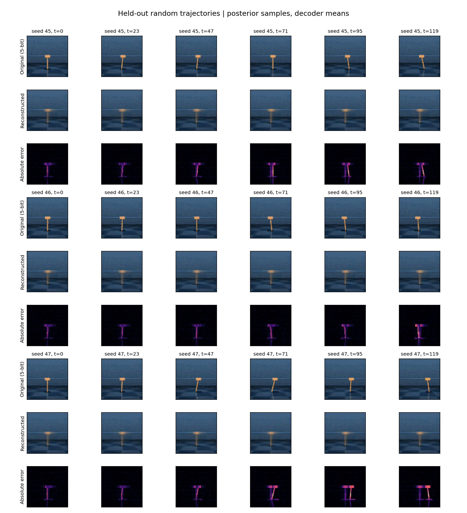
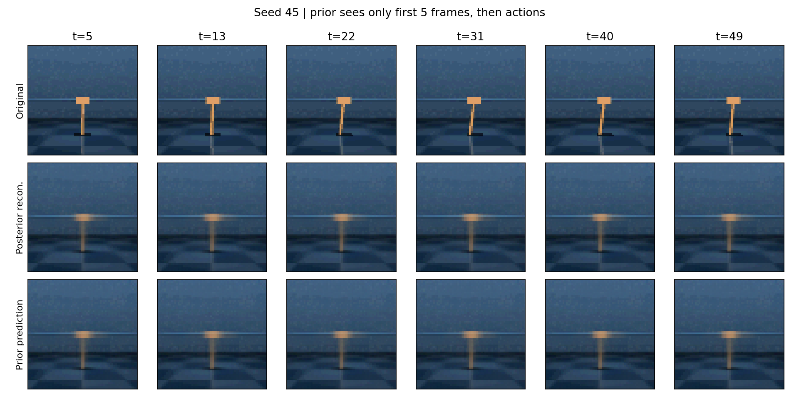
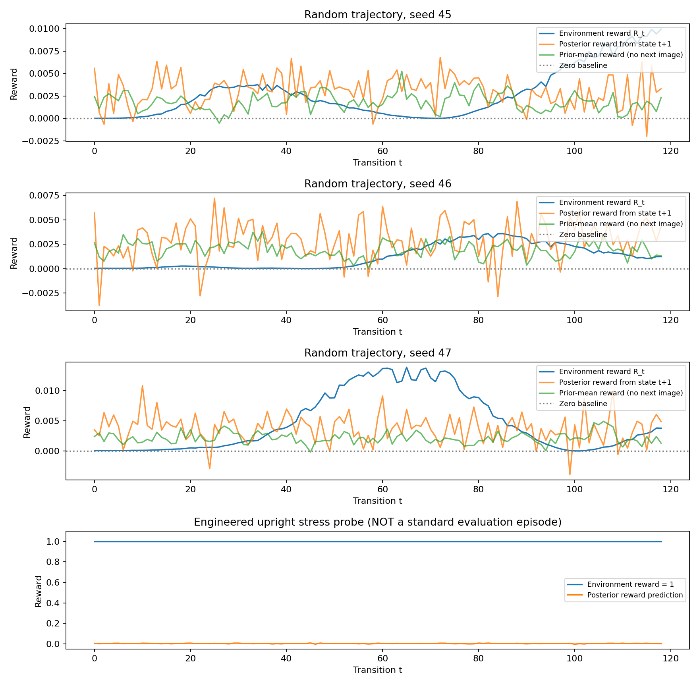

# Lyra ? RSSM World-Model Audit and Experimental Results

This audit checks the RSSM architecture, reconstruction from an existing checkpoint, reconstruction loss, and reward prediction. **Network shapes, distributions, and backpropagation passed, but the short-trained model mainly recovered static backgrounds and did not reliably reconstruct moving objects or predict rewards.** The original audit did not retrain or modify the model, pilot scripts, or checkpoint.

Reference: DreamerV1, Section 4 / Equations (9)?(10) on page 6, Appendix A on page 14, and Figure 5 on page 5 for the distinction between posterior reconstruction and prior open-loop prediction. This is an audit of the current pilot, not a paper-scale reproduction. See [the November 20 handoff](NOV20_HANDOFF.md) for subsequent loss versioning and replay-boundary work; the measurements below remain historical pilot results.

## 1. RSSM Implementation Checks

| Component | Implementation and tensor dimensions | Findings |
| --- | --- | --- |
| Encoder | `3x64x64 -> 32x31x31 -> 64x14x14 -> 128x6x6 -> 256x2x2 -> 1024` | Four stride-2 convolutions with ReLU; matches `feat_dim=1024` |
| GRU | `h_(t+1) = GRU([z_t, a_t], h_t)`; Cartpole input 30+1, hidden size 200 | Recurrence order and dimensions are correct |
| Prior | `p(z_t given h_t)`; 200 hidden features to 30 means and standard deviations | `Independent(Normal(...), 1)`; no current image input |
| Posterior | `q(z_t given h_t, enc(o_t))`; input 200+1024 | Diagonal Gaussian; `rsample()` supports reparameterized gradients |
| Standard deviation | `softplus(pre_std + 0.55) + 0.01` | Positivity and minimum-scale checks passed |
| Decoder | `[h_t,z_t] (230) -> 1024 -> reshape -> transposed convolutions -> 3x64x64` | Image shape is correct; output standard deviation is fixed at 1 |
| Reward head | `[h_t,z_t] -> 200 -> 200 -> 1` | Scalar Gaussian with unit standard deviation; mean is not restricted to [0,1] |
| KL | Posterior-to-prior KL, with 3 free nats per time/sample after summing latent dimensions | Direction, event reduction, and free-nats floor are consistent |

The checkpoint loaded strictly and contains **2,644,220** parameters. All six modules had finite, nonzero parameter gradients.

The structure follows the basic continuous-Gaussian RSSM decomposition, but this does not establish an exact DreamerV1 reproduction. For example, the current reward head uses two 200-unit ReLU layers, whereas Appendix A describes other dense functions with three 300-unit ELU layers. Training budgets and hyperparameters also differ. Dreamer reports that latent overshooting is unnecessary for its experiments; its absence alone is not an implementation error.

## 2. Evaluation Setup

- Checkpoint: `midterm_pilot_v2_checkpoint.pt`; **1,440** recorded training environment steps; training environment seed 42.
- SHA-256: `575ebf2268fbc480b1c41422576a7157ef2855e3a6d61269fa960be39199f3fb`.
- Environment: DMC `cartpole/swingup`, camera 0, 64x64 RGB, one underlying step per action (`action_repeat=0` in the historical configuration).
- Random-action trajectories from new environment seeds **45, 46, 47**, each **120 steps**: 360 images and 357 aligned reward pairs. These are not independent training seeds.
- Main results sample posterior latents and use decoder/reward distribution means, without additional image noise. Model RNG seed is `10000 + environment_seed`.
- Preprocessing preserves historical 5-bit quantization, float16 preprocessing rounding, and `H,W,C -> C,W,H` ordering. Display reverses this correctly; evaluating old weights after switching to `C,H,W` would change their inputs.
- Additional deterministic posterior-mean diagnostics do not replace the main stochastic-latent results.
- Raw images, actions, and rewards are saved in `trajectories.npz` for offline reproduction.

## 3. Original vs. Reconstructed Images



Six uniformly spaced times per seed show the original 5-bit model input, reconstruction, and absolute error. Images were not selected for reconstruction quality. Only display images are clipped to [0,1]; metrics use unclipped network outputs.

| Environment seed | Pixel MSE | PSNR / dB | Pixel SSE per frame | First-frame-copy MSE |
| --- | ---: | ---: | ---: | ---: |
| 45 | 0.001671 | 27.77 | 20.532 | 0.002727 |
| 46 | 0.001192 | 29.24 | 14.652 | 0.001100 |
| 47 | 0.002223 | 26.53 | 27.317 | 0.003304 |
| Pooled, 360 frames | **0.001695** | **27.71** | **20.834** | ? |

MSE uses normalized pixels; per-frame SSE = MSE x 12,288. PSNR uses `data_range=1`; pooled PSNR is computed from pooled MSE. The first-frame-copy baseline repeats the initial image throughout each trajectory to test whether static scenery makes errors misleadingly small.

**Interpretation:** Background texture and colors are recovered, but the cart and pole remain blurred and nearly stationary. On seed 46, the model is slightly worse than copying the first frame. Approximately 28 dB PSNR does not establish accurate position, angle, or dynamics learning.



Following the context/prediction distinction in Figure 5, the model receives five context frames and then predicts 45 frames using actual actions and prior transitions only. Open-loop MSE is **0.001128 / 0.000929 / 0.001092** for the three trajectories. These windows differ from the full 120-frame reconstruction evaluation, so the MSE values are not directly comparable. Outputs again resemble a static average scene; background-dominated pixel error does not establish accurate long-term prediction.

## 4. Reconstruction-Loss Audit

Equation (10) uses observation/reward log likelihood and KL. For a Gaussian with fixed standard deviation 1, negative log likelihood is `0.5 * SSE + constant`.

Two historical objectives must be distinguished:

1. **Original `planet.py::compute_loss`:** samples decoder/reward distributions with `rsample()` before computing squared error. Unit variance adds an expected **12,288** to image SSE and **1** to scalar reward MSE. This does not change the mean-regression optimum in expectation, but adds loss and gradient noise and makes logged values difficult to interpret as prediction error. Reward targets are also unshifted.
2. **Actual `midterm_pilot_v2.py::aligned_loss`:** overrides the original function at runtime, uses distribution means, and shifts reward targets by one frame. The evaluated checkpoint came from this pilot. Problems in the original loss cannot automatically be attributed to its training.

On the same short batch and prediction distributions, eight original-loss calls yielded an image term of **12,297.81 ? 44.80**, versus mean-reconstruction SSE **11.8794**, consistent with approximately 12,288 extra error from unit variance. The standard deviation is across eight diagnostic calls, not training seeds. Original reward loss averaged 1.2965; its small sample and different alignment prevent attributing all differences to sampling noise.

The pilot avoids output-sampling noise but uses full SSE/MSE rather than half SSE/MSE. Its likelihood-to-KL weighting therefore differs from unit-Gaussian NLL plus KL. Diagnostic `mean_objective()` deliberately preserves the pilot scale. Subsequent v2 work is documented separately in the handoff.

## 5. Reward-Prediction Audit

Historical replay stores `(o_t, a_t, R_t)`, where `R_t` is returned after action `a_t`. The current state is inferred from the pre-action image. Consistency with CEM's successor-state reward convention requires:

```text
state_t -- action_t --> state_(t+1)
reward_head(state_(t+1))  corresponds to R_t
predicted_rewards[1:]    correspond to stored_rewards[:-1]
```

The first state has no matched incoming reward, and the final stored reward has no matched successor image; both unmatched boundaries are excluded. Alignment follows data semantics, not whichever shift minimizes error. The pilot shift is consistent; the original unshifted target is not.



| Environment seed | Aligned posterior MSE | All-zero predictor MSE | R? | Maximum true reward |
| --- | ---: | ---: | ---: | ---: |
| 45 | 1.2251e-5 | 1.5222e-5 | -0.613 | 0.00995 |
| 46 | 8.1817e-6 | 2.9597e-6 | -4.448 | 0.00359 |
| 47 | 2.8777e-5 | 4.4793e-5 | -0.250 | 0.01385 |
| Pooled, 357 pairs | **1.6403e-5** | **2.0992e-5** | **-0.291** | ? |

Every trajectory has negative R?: prediction is worse than retrospectively using that trajectory's true mean reward. This constant uses test targets and is an interpretive reference, not a deployable policy. Pooled MAE is **0.003162**.

Prior-mean reward prediction before observing the successor image has pooled MSE **1.5081e-5**. This checks the path without successor observations, but differs from CEM's sampled latent rollouts. All diagnostic reward metrics use raw predictions without planner clipping.

**Additional high-reward probe:** In a separate environment, setting `qpos=qvel=0` makes the pole exactly upright. Over 120 zero-action steps, true reward remains **1.0**, mean posterior prediction is **0.003324**, and aligned MSE is **0.993367**. This is an engineered diagnostic, not a default reset, policy-return evaluation, or benchmark. It exposes weak generalization beyond the low-reward trajectories, but does not alone demonstrate an architectural bug.

**Assessment:** Small absolute errors on low-reward trajectories do not establish reliable reward prediction. The checkpoint neither consistently beats simple references nor recognizes the high-reward probe, so its reward head is not yet established as a reliable planning or actor-training signal.

## 6. Issues to Address Before Integration

- **Unify loss and time conventions:** Explicitly select incoming-reward targets and likelihood scaling in the training entry point; preserve historical checkpoint semantics. See the handoff for the subsequent implementation.
- **Preserve historical pixel ordering:** Old weights use `C,W,H`. A future switch to `C,H,W` requires an explicit preprocessing version and retraining, not an evaluation-only change.
- **Separate training and evaluation:** Original `Planet.forward` adds Gaussian pixel noise even in eval mode and uses configured batch/sequence sizes. This audit directly calls submodules for filtering without added noise. A future interface should infer sizes and expose a noise switch. Standard pixel dequantization also differs from this zero-mean Gaussian noise.
- **Increase training and data coverage:** 1,440 environment steps cannot establish paper-level performance. Include successful swing-up and high-reward coverage, and report object details, multi-step prediction, and reward baselines alongside total loss.
- **Repair historical video evaluation:** `ModelBasedLearner.evaluate_video_prediction` nests future prediction inside the context loop and mismatches image indices. The audit independently implements five context frames plus 45 prior-only predictions.

These were findings and recommendations from the original audit, which preserved the historical training scripts and weights.

## 7. Artifacts and Reproduction

| File | Contents |
| --- | --- |
| `../rssm_diagnostics.py` | Checkpoint loading, DMC data collection, reconstruction/reward/open-loop diagnostics, plots, and offline replay |
| `../test_rssm_diagnostics.py` | Five checks: network/gradients, pixel ordering, reward boundaries/errors, and Gaussian NLL scaling |
| `reconstruction_comparison.png` | Original/reconstruction/error for three seeds |
| `reward_prediction.png` | Posterior/prior-mean reward predictions, targets, and upright probe |
| `open_loop_prediction.png` | Open-loop predictions after five context frames |
| `metrics.json` | Metrics, configuration, environment versions, checkpoint hash, and checks |
| `trajectories.npz` | Raw RGB, actions, rewards, and predictions; no pickle; supports offline reproduction |

From the repository root, using the prepared Python environment:

```bash
python -m pip install -r planet_baseline/requirements-rssm-audit.txt
python -m unittest discover -s planet_baseline -p test_rssm_diagnostics.py -v

# Replay supplied real trajectories without DMC, MuJoCo, or graphics context.
# Use a different output directory to preserve the original artifacts.
python planet_baseline/rssm_diagnostics.py --data planet_baseline/rssm_audit/trajectories.npz --output planet_baseline/rssm_audit_replay

# Install rendering dependencies in a supported environment for fresh collection.
python -m pip install dm-control==1.0.49 mujoco==3.16.0
python planet_baseline/rssm_diagnostics.py --output planet_baseline/rssm_audit_fresh
```

The original run used repository `.venv-rssm`, shared installed torch/numpy packages, Windows 11, Python 3.13.7, and CPU. See `metrics.json` for versions. **Windows/Python 3.13 workaround:** The labmaze dependency lacked a compatible wheel, and source building required unavailable Bazel. The following installed Cartpole dependencies and DMC without dependency resolution; Cartpole rendering and collection were verified. This does not establish that other DMC modules have complete dependencies or that earlier Colab returns reproduce exactly.

```bash
python -m pip install absl-py dm-env dm-tree glfw mujoco==3.16.0 pyopengl lxml protobuf pyparsing setuptools scipy requests
python -m pip install --no-deps dm-control==1.0.49
```

The original audit passed **5/5 checks**, real-environment evaluation, and offline replay. It evaluates one short-trained checkpoint on three 120-step environment trajectories, not training-seed stability or long-term control. The later handoff reports the expanded ten-test suite separately.

## Progress-Report Summary

We checked the RSSM encoder/decoder, GRU, Gaussian prior/posterior, and reward head; network dimensions and backpropagation passed. A 1,440-step checkpoint evaluated on 360 frames from three new Cartpole-Swingup environment seeds achieved pixel MSE 0.001695 and PSNR 27.71 dB. Backgrounds were recovered, but moving objects were blurred and open-loop predictions were nearly static. Pooled reward R? was -0.291, and an upright probe exposed weak high-reward generalization. The original loss sampled additional observation/reward noise, whereas actual pilot training used means and shifted rewards. Consistent objectives, longer training, and broader reward coverage are needed before controller comparisons.
